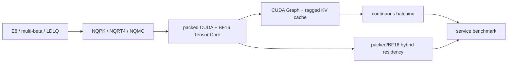

# NestQuant-AIInfra

面向 AI Infra / 大模型压缩岗位的 NestQuant 论文复现与量化评测项目。项目从 E8 最近格点、嵌套格编码和 multi-beta 选择开始，逐步实现 block-LDLQ、W4/W4KV4/W4A4KV4 质量仿真、低比特权重容器，以及 Llama-3.2-1B 上的 QuaRot 同任务兼容性对照。

本项目强调可审计证据：固定模型与数据 revision，记录 token 哈希、校准集、配置、耗时和原始 manifest；严格区分质量仿真、真实低比特存储和低比特 kernel 加速。

## 五分钟审阅路径

第一次查看项目时，建议按下面的顺序阅读：

1. 本页“核心结果”和“证据边界”，确认项目解决的问题与不能声称的内容；
2. [项目架构](docs/architecture.md)，理解算法、模型适配、文件格式、CUDA runtime 和调度的依赖关系；
3. [当前正式结果](docs/current_results.md)，只引用当前协议，不把历史实验混入结论；
4. [混合驻留 Pareto](results/llama32_1b_nqrt4_hybrid_pareto.md)，查看显存—TTFT—TPOT 的系统权衡；
5. [面试讲解手册](docs/interview_guide.md)与[工程故障复盘](docs/incident_postmortems.md)，查看贡献归属、负结果和排错能力。

项目主线：



核心贡献不是把“模型文件变小”直接等同于“推理加速”，而是分别建立量化质量、实际存储、
packed-resident 执行、动态调度和显存—延迟策略的证据链。

## 核心结果

模型与评测协议：

- `meta-llama/Llama-3.2-1B`
- `Salesforce/wikitext/wikitext-2-raw-v1` test
- context length 2048
- 141 个完整窗口，288,627 个预测 token
- test token SHA256：`54927bf19e6e64b4008eeb93370c370fb25db18cf68eac8015cfe094c464d567`

| 方法 | WikiText-2 PPL | 说明 |
|---|---:|---|
| BF16 | 9.758112 | WSL/CUDA 统一基线 |
| RTN W4 | 13.023722 | 对称 group-wise RTN 基线 |
| NestQuant 普通 W4 | 11.202577 | E8 嵌套格、多 beta |
| NestQuant block-LDLQ W4 | 10.276601 | 64 个训练窗口校准 |
| NestQuant block-LDLQ W4，共享校准 | 10.277472 | 与 QuaRot 相同的 128 个随机训练窗口；量化 `lm_head` |
| NestQuant block-LDLQ W4，同范围 | **10.211760** | 128 个共享窗口；与 QuaRot 一样保留 `lm_head` BF16 |
| NQRT v4 stateless dither + 论文式 Hadamard + shared128 LDLQ W4 | **10.070482** | 112/112 v4 record；完整 NQMC 回载；支持 GPU tile 随机访问 dither |
| 论文式 Hadamard + shared128 LDLQ W4/W4KV4/W4A4/W4A4KV4 | **10.076886 / 10.515783 / 10.689190 / 11.232054** | NQRT v3 上游 E8 语义；A4/KV4 为质量仿真 |
| 论文式 Hadamard + shared128 LDLQ W4A4 | **10.689190** | NQRT v3；A4 直接作用于局部 `X H`；固定上游全局 beta |
| NestQuant W4KV4，共享校准 | 10.668994 | 同一 NQMC W4；E8 post-RoPE K/V fake quant |
| NestQuant W4A4，共享校准 | 10.952032 | 同一 NQMC W4；E8 Linear 输入 fake quant |
| NestQuant W4A4KV4，共享校准 | **11.504096** | 同一 NQMC W4；激活与 KV 质量仿真 |
| QuaRot 兼容移植 GPTQ W4 | 10.508346 | 官方关键 GPTQ 参数，128 个校准窗口 |
| QuaRot 兼容移植 W4A4KV4 | 21.095586 | 标量 per-token A/K/V fake quant |

QuaRot 官方仓库没有原生支持 Llama-3.2-1B。这里的对照是明确记录的兼容移植：增加纯 PyTorch Hadamard fallback，修复 GQA K-cache reshape、共享 embedding/lm_head 和 Transformers 4.46 GPTQ 设备放置。它不是官方 CUDA kernel 复现。

完整解释见 [共享校准 W4/A4/KV4 递进实验](results/llama32_1b_shared128_w4a4kv4_progression.md)、[共享校准与同范围 W4 对照](results/llama32_1b_shared_calibration_w4.md)和 [NestQuant 与 QuaRot 全矩阵报告](results/llama32_1b_quarot_comparison.md)。

PIQA/HellaSwag zero-shot 全量评测也已完成。NQMC W4 相对 BF16 的 `acc_norm` 分别下降 1.14/1.41 个百分点，W4A4KV4 分别下降 4.03/4.27 个百分点。三档结果使用相同模型 revision、任务定义和逐样本身份；W4A4KV4 的 260.6 分钟耗时来自 Python/PyTorch fake-quant 参考路径，不能解释为低比特 kernel 性能。详见[下游评测报告](results/llama32_1b_downstream_full.md)。

## 实现内容

- **E8 与嵌套格**：最近格点、Voronoi residue、subtractive dither 和 `q=2` 全码字往返验证。
- **Multi-beta**：实现 Appendix F First-beta 子集动态规划，并与穷举搜索交叉验证。
- **模型权重量化**：独立 E8 block W4、8-column block-LDLQ、Hessian 坐标旋转和 QA-LDLQ 适配。
- **激活与 KV**：七类 Llama Linear 输入 A4；post-RoPE Q/K 匹配旋转；逐 attention-head KV4。
- **真实权重容器**：NQPK/NQRT/NQMC 固定宽度码流、beta ID、row norm、dither 状态、共享权重别名及完整模型回载。
- **NQRT v4 与 compiled runtime 原型**：stateless random-access dither 在 CPU/CUDA 与任意分块下逐比特一致；真实 1B checkpoint PPL 10.070482；单个 tiled Triton kernel 融合 packed code/beta 读取、dither、E8 重建和行缩放，真实 checkpoint 112/112 权重与参考 BF16 输出逐比特一致。它仍会物化 BF16 权重，尚未融合 GEMM。
- **存储路径与整模型 runtime 诊断**：同一 NQMC 的 112 条量化记录在 WSL ext4 与 Windows `/mnt/d` 上交替读取 7 轮，均值为 0.121/1.485 秒；ext4 上 warm lazy forward 为 0.298/0.314 秒，CUDA peak 846 MB，logits 与完整反量化基线逐比特一致，但仍慢于 78.18 ms 的 BF16 常驻基线。
- **解码/GEMM 重叠边界**：双 CUDA stream 的隔离实验在 sequence length 2048 的 q→k、gate→up、up→down 上分别获得 1.21×/1.35×/1.10×，但 length 1/8 无一致收益；双流调度适合长上下文 prefill，不是逐 token 生成中物化 BF16 权重的通用解法。
- **Packed-weight fused Linear 原型**：真实 2048×2048 q_proj 的 NQRT 常驻数据为 2.24 MB（BF16 权重的 26.66%），kernel 在 E8 解码后直接累加 Linear 输出，不生成完整 BF16 权重；sequence length 1/8/16 的临时峰值仅为输出大小。RTX 5070 上扫描 135 组 tile/warp 配置并用 100 次独立计时确认后，新默认配置使融合路径自身中位延迟降低 20%/29%/35%，正式 50 次基准比 decode-then-GEMM 快 1.16×/1.20×/1.20×；当前仍是单层、非 Tensor Core 原型，不能外推为完整模型加速。
- **真实 Transformer block 接入**：新增可选择性替换标准 `nn.Linear`/Hadamard Linear 的 `FusedNQRTLinear`，首次调用按需读取 NQMC 并让 packed 流常驻 GPU。Llama block 0 的 Q/K/V/O 与 gate/up/down 七个投影从 121.63 MB BF16 降至 32.40 MB packed（26.64%）；共享 QKV 和 gate/up 的输入 Hadamard 后，sequence length 1/8/16 的稳态 block 延迟约 5.96/5.89/5.94 ms，仍慢于 BF16 权重常驻参考的 3.82/3.80/3.57 ms。共享变换仅改善 0%～1.4%，证明主瓶颈是七次 packed 点积和 kernel launch；下一步需要融合 QKV、gate/up 并利用 Tensor Core。
- **Grouped packed QKV kernel**：真实 block-0 Q/K/V（2048/512/512 × 2048）保留各自 payload、beta table 和 dither seed，通过一个三维 Triton grid 同时调度；三个输出与独立 fused kernel 逐比特一致，sequence length 1/8/16 的三次 launch 中位延迟 0.8315/0.8272/0.8095 ms 降至单次 grouped launch 的 0.7417/0.7584/0.7599 ms，即加速 1.121×/1.091×/1.065×。这是隔离 QKV kernel 结果，尚未代表完整 attention 或 block 加速。
- **Grouped QKV 模型接入边界**：通过一次计算、三次领取、消费后清空的 coordinator 接入真实 `LlamaAttention`；block 级 seq 1/8/16 延迟由独立 QKV 的 5.9640/5.8931/5.9380 ms 变为 6.0506/5.8958/5.8766 ms，即 -1.4%/约 0%/+1.0%。隔离 kernel 收益未形成稳定 block 加速，下一步需 grouped gate/up 或更高效的 Tensor Core 点积。
- **Grouped gate/up 停止条件**：真实 block-0 gate/up 均为 8192×2048；一次 grouped launch 与两个独立 fused kernel 逐比特一致，但 seq 1/8/16 延迟由 1.8892/1.8774/1.8796 ms 增至 1.8983/1.9031/1.9372 ms，即慢 0.5%/1.4%/3.0%。隔离实验已否决模型接入，launch-only 优化分支结束，下一步必须转向 `tl.dot`/Tensor Core 兼容的数据流。
- **Tensor Core block-dot 与真实 block 接入**：kernel 内按 `[N,K/8,8]` 独立恢复 E8 block，reshape 为 BF16 权重 tile 后交给 `tl.dot`；PTX 已核验包含 `mma.sync.aligned.m16n8k16...bf16`。四类 Llama 投影形状的 192 个配置均成功，最佳路径相对标量 fused kernel 加速 1.537～2.315×。接入 block 0 七个投影并按每后端 100 次背靠背测量后，seq 1/8/16 的 Tensor Core/scalar 延迟为 3.9220/4.0625/3.8935 ms 对 6.7680/6.6069/6.1182 ms，即加速 1.726×/1.626×/1.571×；packed 权重仍仅占 BF16 的 26.64%，但 block 仍比自身 BF16 常驻参考慢 18.6%～28.0%。这是“packed 解码到 BF16 后使用 Tensor Core”，不是 INT4 Tensor Core GEMM，也不是端到端模型加速。
- **长 prefill 解码复用**：将 `BLOCK_M` 从固定 16 扩展到 32/64/128，四类投影的 612 个候选均成功。seq 32/64/128 的真实 block Tensor Core/scalar 延迟为 3.5856/3.8294/4.3292 ms 对 8.2970/14.5623/26.6830 ms，即加速 2.314×/3.803×/6.164×；seq128 延迟下降 83.8%，证明跨 M tile 重复恢复权重是旧路径的主要长序列瓶颈。Tensor Core block 仍比 BF16 常驻慢 21.9%/26.7%/45.3%，下一步需要 kernel 级剖析而非继续盲目增大 tile。
- **Tensor Core kernel 剖析**：PyTorch Profiler 中七个 NQRT kernel 占 packed block GPU 自耗时的 79.3%～85.4%，其中 gate/up/down 合计占 fused Linear 时间约 71%～73%。保持 packed 读取、coset、缩放和 `tl.dot`、仅编译期移除 RNG 与两次 E8 投影的无语义消融，使 q/gate/down 在 seq 1/128 的 kernel 时间减少 61%～76%；因此下一目标是拆分并优化 dither/E8 重建，而不是 Hadamard 或继续增大 M tile。
- **E8 分项消融与 `gather` 优化**：分开移除 dither E8、coarse E8 和 RNG hash 后，结果受寄存器压力与调度影响并不满足简单可加性，不能把时间精确分摊给单项；稳定结论仍是两次 E8 最近点搜索为主瓶颈，而 RNG 单独不是。将两处“8 路 `where` 选择后 `sum`”改成 `tl.gather` 直接抽取目标残差后，q/gate/down 在 seq 1/128 的单投影中位延迟下降 5.6%～23.0%；真实 block 的 seq 32/64/128 packed 延迟由 3.5856/3.8294/4.3292 ms 降至 3.4252/3.4713/3.7180 ms，即改善 4.5%/9.4%/14.1%，且保持数值回归通过。
- **E8 局部优化停止条件**：合并两陪集误差归约会把 down_proj 最大输出误差放大到 0.177734/0.265625 且变慢 1.5%～9.5%；48/56/64 寄存器上限没有跨形状、跨顺序的稳定收益；用残差符号与奇偶性替代第二次 `nearbyint` 虽保持误差不变但变慢 5.7%～16.1%。三条候选均未进入生产分派，说明下一阶段需要改变内核组织或运行时存储权衡，而不是继续做局部代数改写。
- **全模型端到端推理**：新增 `scripts/benchmark_full_nqrt_model.py`，将 Llama-3.2-1B 全 16 层 112 个 projection 替换为 packed NQRT，统一测量 BF16、scalar packed、Tensor Core packed 的 steady prefill、TTFT、TPOT、生成吞吐和 CUDA 显存。batch size 1、seq 1/128/512 的 Tensor Core packed prefill 为 65.946/64.465/172.981 ms，较 scalar packed 的 116.472/509.092/1,849.901 ms 加速 1.77×/7.90×/10.69×；仍比 BF16 resident 慢 6.35×/5.02×/6.60×。完整模型 warmup 后 CUDA allocation 由 2,390.1 MB 降至 1,028.6 MB（下降 57.0%），证明当前阶段的端到端收益主要是显存—延迟权衡，而非超过 BF16 的低延迟。详见[全模型端到端报告](results/llama32_1b_nqrt4_full_e2e.md)。
- **全模型 batch/长上下文扩展**：同一端到端 harness 已覆盖 batch 2/4 seq128 与 batch1 seq2048；batch4 Tensor Core packed prefill 为 165.44 ms，scalar packed 为 1,978.86 ms；seq2048 Tensor Core packed 为 562.6 ms，较 scalar packed 的 7,045.8 ms 加速约 12.5×，但仍比 BF16 resident 慢约 5.5×。batch4 的 packed warm allocation 仍约 1.03 GB，seq2048 packed 峰值约 1.00 GB，当前 1B 模型在 RTX 5070 上尚未达到显存容量拐点；下一阶段需要选择更大模型、更多 batch 或更底层 CUDA kernel 才能继续放大系统差异。
- **可复用 CUDA Graph 解码**：新增固定 batch 的 `NQRTGraphDecodeRunner`，以固定地址 `StaticCache` 捕获完整单 token 模型前向，并允许每次重放更新 token 与 cache position；同时修复 J2 自定义 kernel 未使用 PyTorch current stream、因而可能漏出 Graph 捕获的问题。Llama-3.2-1B packed NQRT4 在 RTX 5070 上连续生成 32 token 与 eager BF16 logits/argmax 完全一致；batch 1 中位 decode-forward 延迟由 40.43 ms 降至 16.61 ms（2.43×），batch 16 由 40.34 ms 降至 20.90 ms（1.93×，765.57 aggregate token/s）。该结果不包含动态请求调度、采样或 tokenizer/网络开销，详见[可复用 CUDA Graph runner 报告](results/llama32_1b_nqrt4_graph_runner.md)。
- **Continuous-batching 服务负载**：新增统一 open-loop harness，在 steady 50 req/s、16×3 burst 和 Poisson 20 req/s 双峰长短请求上，将选定的 `8/4` admission 与即时 `1/0` 各重复 3 次。预热全部 4～48 prompt width 后，`8/4` 的 token throughput 分别提高 42.1%/46.2%/16.2%，TTFT P95 分别降低 47.5%/51.0%/33.8%；18/18 次 run、864 个请求全部完成且无注册表残留。该结果无 tokenizer/网络，不是生产 QPS，详见[服务级 engine benchmark](results/llama32_1b_nqrt4_service_benchmark.md)。
- **服务容量拐点**：在请求内容完全配对、只改变到达率的 4/10/20/30/40/50 req/s 扫描中，30→50 offered req/s 仅将 token throughput 从 121.61 提高到 129.10 token/s，却把 TTFT P95 从 335.99 增加到 746.94 ms，定位当前配置约 25～30 req/s 的饱和拐点。该结果是有限合成 engine sweep，不是 HTTP QPS 或无限时长稳定速率，详见[服务容量扫描](results/llama32_1b_nqrt4_service_capacity.md)。
- **可审计 checkpoint**：bounded-memory inspector 可在不加载模型、不反量化权重的情况下核验 NQMC/NQRT 版本、payload/file SHA-256、codec semantics、tensor 构成和实际码率。
- **选择性解码基线**：NQMC 支持 O(1) 按名称/alias 定位并只解码一个 tensor；真实 q/down projection 的 CUDA 解码基线已定位 float32 中间张量与峰值内存瓶颈。
- **分块目标 dtype 解码**：row-range bit unpack 与 bit-exact dither replay 可直接写入 BF16；`down_proj` 的单 tensor CUDA decode peak 从 850.01 MiB 降至 119.13 MiB，尚未接入 GEMM。
- **论文式局部旋转**：112 个 Llama Linear 支持离线保存 `W H`、在线计算 `X H`、旋转坐标 W4/LDLQ/A4 和自包含 NQMC 回载；当前上游语义 NQRT v3 W4/W4A4 PPL 为 10.076886/10.689190。
- **外部基线**：完成 QuaRot Llama-3.2-1B 兼容移植和 BF16/W4/W4KV4/W4A4/W4A4KV4 完整消融。
- **实验审计**：保存 revision、token 哈希、配置哈希、校准 provenance、阶段耗时和失败状态。

## 证据边界

| 层级 | 当前状态 | 可以证明什么 |
|---|---|---|
| 量化质量仿真 | 已完成 | 相同任务协议下的 PPL 和量化误差 |
| 真实低比特权重存储 | 已完成 NQMC | 打包文件大小、无 Hessian 回载、回载 PPL 一致性 |
| 真实低比特激活/KV 存储 | 未完成 | 当前 A/KV 在运行时仍是浮点重构张量 |
| compiled packed decode kernel | 已完成原型 | 证明真实 packed stream 可直接融合解码，且显著降低单 tensor 解码延迟/中间显存 |
| Packed-weight fused compute | Tensor Core block + 固定 batch CUDA Graph 完成 | 七个 packed NQRT 投影不物化完整 BF16 权重；CUDA Graph 在完整 1B decode-forward 上获得 batch 1/16 的 2.43×/1.93× eager 加速，同时保留 packed 权重显存收益 |
| 优化低比特 GEMM kernel | 未完成 | 不能声称 INT4 Tensor Core GEMM、生产吞吐提升或端到端低比特推理加速 |

train64 block-LDLQ NQMC 文件实测为 659,281,364 字节，能够在不加载 Hessian 的情况下重建权重并复现 PPL 10.276133。该路径仍将权重反量化到 BF16 Linear，因此不代表 INT4 推理加速。

模型回载现已改为分块校验和逐记录反量化。对 1,044,557,140 字节共享校准 NQMC 各运行 3 次，主机 RSS 峰值增量均值由 3.289 GiB 降到 1.467 GiB，CUDA 峰值 allocated 由 7.147 GiB 降到 3.133 GiB；NQMC 阶段耗时由 28.14±4.67 秒增至 39.95±3.06 秒。该结果是加载阶段工程证据，不是推理性能结果；详见[流式回载基准](results/llama32_1b_nqmc_load_benchmark.md)。

## 快速开始

基础算法和 CPU 单元测试不需要下载 Llama 权重：

```powershell
python -m venv .venv
.\.venv\Scripts\Activate.ps1
python -m pip install --upgrade pip
python -m pip install -e .
python -m unittest discover -s tests -v
python scripts/demo_e8.py
python scripts/demo_beta_search.py
python scripts/run_synthetic_matrix_product.py
```

当前共有 246 项主项目测试，覆盖 E8、codec、上游边界 tie-break、NQRT v1-v4 语义兼容、v4 stateless dither 的 CPU/CUDA 与任意分块逐比特一致、multi-beta、beta来源防漂移、离线权重/在线激活Hadamard等价路径、局部 Hadamard 坐标 A4、A4 beta 配置、held-out 窗口隔离与模型级事务替换、旋转元数据回载、LDLQ、packing、流式checkpoint读写、单层 lazy NQMC Linear、共享容量受限 LRU 权重缓存、真实模型自动 lazy 替换及同步分阶段剖析、Triton 定宽流拆包、混合解码、tiled 融合解码、真实 Voronoi 边界回归、packed fused Linear、共享 Hadamard 缓存、真实 block 选择性替换、grouped QKV/Pair 逐比特一致、Tensor Core block-dot 数值边界、短/长 token 实测 dispatch 及 coordinator 生命周期、CUDA Graph runner/Pool、per-request ragged KV cache、host-driven continuous-batching engine、slot 生命周期、admission microbatch、终态请求回收、服务负载生成/统计、配对容量扫描、配置预检、服务报告硬验收/配置绑定/证据提升、混合驻留规划/Pareto 校验与随机/真实 GPU workload soak、统一 runtime 验证编排、仓库发布审计及 Markdown 链接检查、A4/KV4、PPL 聚合与进度回调、共享校准清单、统一复现入口、下游评测cache隔离与同协议汇总、量化范围排除和量化事务回滚。2026-10-27 在 WSL/CUDA 正式环境运行 `python -m pytest -q`，246 项及 25 个 subtests 全部通过。QuaRot 适配补丁另有 6 项 Hadamard/GQA 测试。

最新系统结果增加 packed/BF16 混合权重驻留：在 RTX 5070 上实测六个显存预算点，
512 MiB 方案相对全 packed 将 TTFT/TPOT 中位数降低 42.4%/45.8%，同时相对全 BF16
仍减少 36.3% CUDA allocated memory；六点均为本次有限候选集的 Pareto 非支配点。
策略、完整数据、CUDA Graph 正确性与证据边界见
[混合驻留 Pareto 报告](results/llama32_1b_nqrt4_hybrid_pareto.md)。

CPU、CUDA E8、J2 current-stream 与完整模型 CUDA Graph smoke 可以通过统一入口验证；默认运行前三项，提供 NQMC 后运行全部阶段。每个子阶段现在以硬断言决定成功/失败，并在 `results/raw/` 写出机器可读报告：

```bash
python scripts/verify_runtime.py --stage all \
  --checkpoint results/raw/llama32_1b_paper_hadamard_w4_shared128_ldlq_nqrt4.nqmc
```

只检查计划而不执行测试、编译或模型加载时使用 `--dry-run`。

公开仓库前运行只读卫生审计；它检查已跟踪及未忽略的新文件中的本机绝对路径、疑似凭据、
敏感文件名、失效 Markdown 本地链接和超过 10 MiB 的文件，报告不会打印疑似密钥的内容：

```bash
python scripts/audit_repository.py \
  --json-output results/raw/repository_audit.json
```

安装 wheel 后对应命令为 `nestquant-audit-repository`；服务 benchmark JSON 可用
`nestquant-validate-service-benchmark REPORT.json` 独立验收。正式摘要由
`nestquant-promote-service-benchmark` 生成，再用 `nestquant-verify-service-evidence` 对 raw、config
与摘要做逐字段及 SHA-256 一致性复核。

发布前还可在 `/tmp` 隔离复制 Git 会发布的文件，构建 wheel、运行全测试，并验证安装后的
wheel 包含 CUDA/C++ runtime 源文件：

```bash
NESTQUANT_PYTHON=/path/to/python bash scripts/smoke_publishable_tree.sh
```

## Llama-3.2-1B PPL

模型是 Hugging Face gated repository。先在网页获得访问权，再在本机执行 `hf auth login`；不要把 token 写进命令、代码或 Git：

```bash
python -m pip install -e ".[evaluation]"
hf auth login
python scripts/evaluate_llama_wikitext_ppl.py --device cuda --offline
```

一个窗口的 smoke 可增加 `--limit-chunks 1`，但不能当作完整 PPL。原始运行产物默认写入被 Git 忽略的 `results/raw/`。

推荐先使用统一入口查看、检查和校验整个复现流程：

```bash
python scripts/run_reproduction.py --stage plan
python scripts/run_reproduction.py --stage smoke
python scripts/run_reproduction.py --stage validate --require-raw-evidence
python scripts/run_reproduction.py --stage full --dry-run
```

完整 Llama 复现带有显式确认保护和产物级断点续跑。各阶段含义、正式命令与结果校验规则见 [统一复现工作流](docs/reproduction_workflow.md)。

PIQA/HellaSwag zero-shot下游评测使用固定的`lm_eval==0.4.13`，入口为`scripts/evaluate_downstream_tasks.py`；BF16、共享校准NQMC W4和W4A4KV4三档全量结果已完成。`scripts/summarize_downstream_results.py`只接受协议和逐样本身份一致的结果，并自动生成分数差与正确性翻转报告。固定协议、正式结果和证据边界见[下游评测协议](docs/downstream_evaluation.md)。

正式校准窗口固定在 [`configs/calibration/llama32_1b_wikitext2_train_seed58_n128.json`](configs/calibration/llama32_1b_wikitext2_train_seed58_n128.json)。该文件保存 128 个窗口的起点、逐窗口 token 哈希和总哈希；NestQuant Hessian 与 QuaRot 兼容入口都支持 `--calibration-manifest`，并在运行前验证模型、数据 revision、tokenization 和完整 train token 流。重新生成时应使用一个不存在的输出路径，因为生成器会拒绝静默覆盖正式清单：

```bash
python scripts/create_calibration_manifest.py --offline \
  --output configs/calibration/calibration_candidate.json
```

QuaRot 兼容移植实验入口：

```bash
python scripts/run_quarot_compat.py \
  --nsamples 128 --a4 --kv4 \
  --output results/raw/quarot_gptq128_w4a4kv4_full.json
```

该脚本需要单独准备官方 QuaRot clone 和兼容环境。具体 commit、依赖冲突和补丁见 [适配审查](docs/QuaRot兼容性审查与适配路线.md)、[适配进展](docs/QuaRot_Llama32适配进展.md)和 [`external_patches/`](external_patches/)。

## 项目结构

```text
configs/            版本化实验参数与 beta 配置
nestquant/core/     E8、codec、multi-beta、rotation、LDLQ、packing
nestquant/models/   校准、Hessian、模型量化与 QA 适配
nestquant/evaluation/ A4、KV4、PPL 与结果汇总
nestquant/experiments/ 可导入的实验入口
scripts/            命令行实验、校准、审计和汇总工具
tests/unit/         246 项主项目测试及 25 个参数化 subtests
docs/               算法、架构、协议、路线和证据边界
results/            审核后的小型汇总；raw 大文件不进入 Git
external_patches/   固定上游 commit 的 QuaRot 兼容补丁
```

代码分层见 [架构说明](docs/architecture.md)，固定协议见 [实验协议](docs/experiment_protocol.md)，结果入口见 [results/README.md](results/README.md)。
不租用更大 GPU 时的本地开发顺序、五个完工验收门和目标成熟度见[本地硬件路线与项目完工标准](docs/local_completion_roadmap.md)。

## 重点文档

- [嵌套格 codec](docs/nested_codec.md)
- [Multi-beta 搜索](docs/beta_search.md)
- [block-LDLQ 校准](docs/ldlq_calibration.md)
- [激活量化](docs/activation_quantization.md)
- [KV-cache 量化](docs/kv_cache_quantization.md)
- [低比特容器格式](docs/packing_format.md)
- [QA-LDLQ 负结果与尺度审计](docs/qa_ldlq.md)
- [当前正式结果与历史结果分层](docs/current_results.md)
- [论文、作者代码与本项目对应矩阵](docs/paper_implementation_matrix.md)
- [NestQuant 与 QuaRot 对照](results/llama32_1b_quarot_comparison.md)
- [论文式 Hadamard W4/NQMC smoke](results/llama32_1b_paper_hadamard_w4_smoke.md)
- [论文式 Hadamard W4 完整 WikiText-2 PPL](results/llama32_1b_paper_hadamard_w4_full.md)
- [论文式 Hadamard + shared128 LDLQ 四因素消融](results/llama32_1b_paper_hadamard_ldlq_ablation.md)
- [论文式 Hadamard + shared128 LDLQ W4A4 首窗口 smoke](results/llama32_1b_paper_hadamard_w4a4_smoke.md)
- [论文式 Hadamard + shared128 LDLQ W4A4 完整 WikiText-2 PPL](results/llama32_1b_paper_hadamard_w4a4_full.md)
- [A4 beta 独立 train held-out 选择（负结果，保留上游默认）](results/llama32_1b_a4_beta_holdout.md)
- [局部 Hadamard + shared128 LDLQ W4/W4KV4/W4A4/W4A4KV4 递进](results/llama32_1b_paper_hadamard_w4a4kv4_progression.md)
- [固定上游 E8 边界语义、逐阶段数值对齐与旧 checkpoint 兼容](results/fixed_upstream_codec_alignment.md)
- [NQRT v3 上游 E8 语义最佳 W4 checkpoint 与完整 PPL](results/llama32_1b_paper_hadamard_shared128_ldlq_nqrt3.md)
- [NQRT v4 stateless dither、完整 W4 PPL 与 runtime 对照](results/llama32_1b_nqrt4_stateless_w4.md)
- [NQRT v3 上游 E8 语义 W4/W4KV4/W4A4/W4A4KV4 递进](results/llama32_1b_paper_hadamard_w4a4kv4_nqrt3_progression.md)
- [NQMC inspector 使用与成本边界](docs/nqmc_inspection.md)
- [Llama-3.2-1B NQRT v3 checkpoint 审计](results/llama32_1b_nqrt3_checkpoint_inspection.md)
- [Llama-3.2-1B 单 tensor 选择性解码基线](results/llama32_1b_nqrt3_selective_decode.md)
- [Llama-3.2-1B 分块 BF16 选择性解码](results/llama32_1b_nqrt3_chunked_bf16_decode.md)
- [固定作者代码与局部 Hadamard A4 语义对齐](docs/upstream_activation_alignment.md)
- [A4 beta 校准协议](docs/activation_beta_calibration.md)
- [简历证据边界](docs/resume_evidence.md)
- [90 秒介绍、简历四条与高频追问](docs/interview_guide.md)
- [工程故障复盘](docs/incident_postmortems.md)
- [GitHub 发布检查清单](docs/release_checklist.md)

## 论文与上游来源

- NestQuant paper: <https://arxiv.org/abs/2502.09720>
- NestQuant authors' repository: <https://github.com/cookiedoth/nestquant>
- QuaRot repository: <https://github.com/spcl/QuaRot>

论文表格值、上游代码行为和本项目实测结果在文档中分别标注。未经本地验证的结论不会写成本项目结果。
