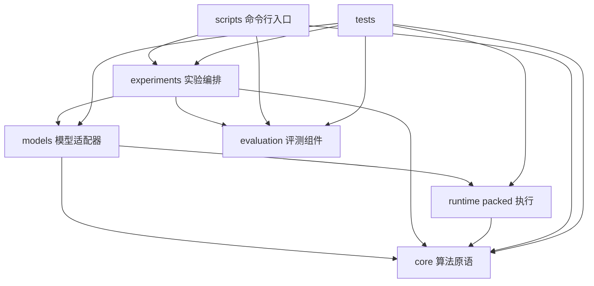

# 项目架构与依赖边界

## 设计目标

项目同时承担论文算法核验、模型质量评测和 AI Infra 工程展示。代码按变化原因分层：数学算法可以单独测试；模型适配器依赖算法核心；评测器不耦合模型下载；具体实验负责把数据、方法与指标组合起来。

## 目录职责

```text
nestquant/
  core/          E8、嵌套码、beta 搜索、行量化等算法原语
  models/        将量化算法应用到 PyTorch 模型的适配器
  evaluation/    tokenization、PPL 和运行结果汇总
  experiments/   合成矩阵、LLM 等端到端实验编排
  runtime/       packed CUDA/Triton kernel、模型接入与 CUDA Graph runner
  cli/           可复用的检查和验证入口
scripts/         命令行入口；正式实验为薄包装，demo 直接调用 core
configs/         可审计、版本化的默认实验参数
tests/unit/      与实现层对应的分层单元测试
results/raw/     本地不可变运行记录（git ignored）
results/         人工复核后可提交的汇总与解释
docs/            论文协议、架构、路线图和证据边界
```

## 依赖方向



`core` 不导入 Transformers、Datasets 或模型层；`evaluation` 只处理 token IDs 和模型 forward 接口，不负责下载模型；`models` 负责把算法作用到 `nn.Module`，但不计算 PPL；实验层组合各层，并记录配置、环境、结果和错误。这样 toy 测试无需下载模型，模型仓库鉴权失败也不会妨碍数学核心测试。

## 公开导入路径

新代码使用领域路径，便于读者识别职责：

```python
from nestquant.core.lattice import nearest_e8
from nestquant.core.quantizer import quantize_rows
from nestquant.models.quantization import quantize_nestquant_w4_
from nestquant.evaluation.perplexity import evaluate_perplexity
from nestquant.evaluation.result_summary import collect_rows
from nestquant.experiments.matrix_product import run_synthetic_matrix_product
```

旧版 `nestquant.lattice`、`nestquant.quantizer`、`nestquant.model_quantization`、`nestquant.perplexity` 和 `nestquant.matrix_product` 仍保留为薄 re-export 模块。新功能只在领域目录内实现，兼容层不承载业务逻辑。

## 新增模块的放置规则

- 格点、码本、量化器、beta 优化算法放 `core/`，用小张量测试数学性质。
- 对 `nn.Module` 的权重改写放 `models/`，显式写清 fake quant、pack 或 kernel 的阶段。
- 数据切分、指标聚合和通用评测工具放 `evaluation/`，不在其中下载 gated 权重。
- 一次完整对照、消融或 sweep 放 `experiments/`；参数由脚本传入，不隐式读取个人目录。
- 输出原始结果时生成唯一 run ID 和 manifest；汇总程序只读 manifest，不修改原始记录。

安装项目后，`nestquant-eval-ppl` 和 `nestquant-summarize-ppl` 分别映射到 LLM PPL 实验与 manifest 汇总函数；`scripts/` 中同名 Python 文件保留源码目录直接运行入口。

`core/packing.py` contains the NQPK v1 fixed-width residue and beta-index stream container. `core/tensor_checkpoint.py` wraps it in NQRT v4 with row norms, beta values, tensor name, dtype, shape, random-access dither metadata, and an explicit E8 boundary-semantics ID; v1-v3 remain readable through compatibility paths. `core/model_checkpoint.py` provides NQMC v1 model state serialization with dense tensors, quantized tensor records, exact tied-weight aliases, and a streaming atomic writer that does not assemble the full checkpoint as one Python `bytes` object. Export/reload and full v4 PPL have been validated on Llama-3.2-1B. The LDLQ checkpoint records calibration provenance but requires no Hessian at decode time. `runtime/triton_tiled_decode.py` fuses fixed-width packed reads, stateless dither, E8 reconstruction, beta lookup, and row scaling into one tiled Triton kernel; all 112 real packed weights are bitwise equal to the reference BF16 decoder. That decoder materializes a BF16 weight for a conventional GEMM; the fused Linear paths below instead consume packed-resident streams during accumulation. See [packing_format.md](packing_format.md), [the v4 dither specification](nqrt_v4_stateless_dither.md), [codec_semantics.md](codec_semantics.md), and [the tiled-runtime report](../results/llama32_1b_nqrt4_triton_tiled_decode.md).

`runtime/triton_fused_linear.py` adds the first packed-resident fused compute
prototype. It keeps NQRT streams and compact metadata on the GPU, decodes E8
blocks inside the reduction loop, reuses them across a token tile, and writes
Linear outputs without a full BF16 weight. The validated 2048 x 2048 q_proj
uses 26.66% of the BF16 resident-weight bytes and only output-sized temporary
allocation, but remains 11-18% slower than decode-then-GEMM and is not a Tensor
Core implementation. See [the fused Linear report](../results/llama32_1b_nqrt4_fused_linear.md).

`runtime/cuda_mma_linear.py` and the J2 CUDA extension add the current optimized
path: E8 blocks are reconstructed from NQRT4 inside the kernel, converted to
BF16 tiles, and accumulated with Tensor Core MMA. All 112 Llama projections can
run from resident packed streams without materializing complete BF16 weights.
The full 1B model reduced warm CUDA allocation from 2,390.1 MB to 1,028.6 MB,
but remained slower than BF16-resident execution. `runtime/cuda_graph_decode.py`
adds a fixed-batch reusable CUDA Graph runner; batch 1/16 decode-forward was
2.43×/1.93× faster than packed eager under the recorded protocol. These are
BF16 Tensor Core accumulations after E8 reconstruction, not INT4 MMA, and the
Graph result excludes dynamic scheduling and network/tokenizer overhead.

`runtime/ragged_cache.py` and `runtime/ragged_graph_decode.py` keep fixed-address
per-slot KV state while allowing independent cache positions and active masks.
`runtime/continuous_batching.py` owns the waiting/running/terminal lifecycle;
`runtime/inference_engine.py` combines slot reuse, microbatched prefill, captured
decode and host-side greedy sampling. `runtime/service_benchmark.py` contains
dependency-light deterministic workload/statistics primitives, while
`scripts/benchmark_service_workloads.py` performs the GPU experiment and
`scripts/validate_service_benchmark.py` rejects incomplete or internally
inconsistent evidence. See [the service benchmark](../results/llama32_1b_nqrt4_service_benchmark.md).

`runtime/hybrid_residency.py` implements the packed/BF16 residency policy. It
groups projections that share an input transform into atomic choices, ranks
positive candidates by predicted latency saved per incremental MiB, and emits a
deterministic plan for any memory budget. The full-model benchmark validates six
budgets and the 512 MiB plan has also passed ragged CUDA Graph replay and slot
reuse checks. This is a measured finite-set Pareto policy, not an exhaustive or
globally optimal cache solver. See [the hybrid residency report](../results/llama32_1b_nqrt4_hybrid_pareto.md).

`core/model_checkpoint_file.py` adds the file-scale path: it validates the header, manifest, entry bounds and payload checksum without `Path.read_bytes()`, then validates and writes one tensor record at a time. The two-pass design preserves transactional behavior before model mutation. A real 1.04 GB checkpoint comparison records the resulting peak-memory/time tradeoff in [the NQMC load benchmark](../results/llama32_1b_nqmc_load_benchmark.md).

The same reader now indexes canonical record names, resolves tied aliases, and exposes single-record read/selective-decode operations. This is the storage/runtime seam for future lazy layers or fused kernels: current selective decode still materializes a float32 tensor and substantial intermediates, so it is an observability and optimization baseline rather than packed execution. See [the selective-decode benchmark](../results/llama32_1b_nqrt3_selective_decode.md).

## 当前阶段状态

NestQuant LLM adapter 仍属于有限范围复现。普通 W4 与 block-LDLQ W4 已有真实低比特模型文件；质量评测路径会反量化到 BF16，而独立 packed runtime 已能让 112 个 Linear 从 NQRT4 常驻码流执行，并支持按预算混合保留 BF16 权重。权重旋转和 E8 block-LDLQ 已通过旋转协方差组合并完成四组质量消融；KV4 已实现 post-RoPE 匹配 Q/K 旋转与逐 head E8 浮点质量仿真。QA-LDLQ 已实现、完成 2048 倍 Hessian 归一化差异审计，并在有界修正后得到未优于普通 LDLQ 的负结果。固定 capacity 的 ragged CUDA Graph、continuous-batching 调度原型、终态回收、10 分钟真实 GPU soak、三类 open-loop engine benchmark 和六点混合驻留 Pareto 已完成。尚未完成的是非 2 次幂旋转逐项上游对齐、packed A/KV、直接 INT4 Tensor Core GEMM、ragged 多容量 Graph Pool、网络服务和生产级动态调度。具体差距见 [论文实现对应矩阵](paper_implementation_matrix.md)。
