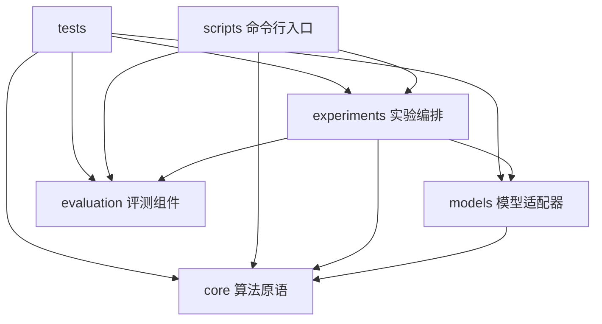

# 项目架构与依赖边界

## 设计目标

项目同时承担论文算法核验、模型质量评测和 AI Infra 工程展示。代码按变化原因分层：数学算法可以单独测试；模型适配器依赖算法核心；评测器不耦合模型下载；具体实验负责把数据、方法与指标组合起来。

## 目录职责

```text
nestquant/
  core/          E8、嵌套码、beta 搜索、行量化等算法原语
  models/        将量化算法应用到 PyTorch 模型的适配器
  evaluation/    tokenization、PPL 和运行结果汇总
  experiments/   合成矩阵、LLM 等端到端实验编排
scripts/         命令行入口；正式实验为薄包装，demo 直接调用 core
configs/         可审计、版本化的默认实验参数
tests/unit/      与实现层对应的分层单元测试
results/raw/     本地不可变运行记录（git ignored）
results/         人工复核后可提交的汇总与解释
docs/            论文协议、架构、路线图和证据边界
```

## 依赖方向



`core` 不导入 Transformers、Datasets 或模型层；`evaluation` 只处理 token IDs 和模型 forward 接口，不负责下载模型；`models` 负责把算法作用到 `nn.Module`，但不计算 PPL；实验层组合各层，并记录配置、环境、结果和错误。这样 toy 测试无需下载模型，模型仓库鉴权失败也不会妨碍数学核心测试。

## 公开导入路径

新代码使用领域路径，便于读者识别职责：

```python
from nestquant.core.lattice import nearest_e8
from nestquant.core.quantizer import quantize_rows
from nestquant.models.quantization import quantize_nestquant_w4_
from nestquant.evaluation.perplexity import evaluate_perplexity
from nestquant.evaluation.result_summary import collect_rows
from nestquant.experiments.matrix_product import run_synthetic_matrix_product
```

旧版 `nestquant.lattice`、`nestquant.quantizer`、`nestquant.model_quantization`、`nestquant.perplexity` 和 `nestquant.matrix_product` 仍保留为薄 re-export 模块。新功能只在领域目录内实现，兼容层不承载业务逻辑。

## 新增模块的放置规则

- 格点、码本、量化器、beta 优化算法放 `core/`，用小张量测试数学性质。
- 对 `nn.Module` 的权重改写放 `models/`，显式写清 fake quant、pack 或 kernel 的阶段。
- 数据切分、指标聚合和通用评测工具放 `evaluation/`，不在其中下载 gated 权重。
- 一次完整对照、消融或 sweep 放 `experiments/`；参数由脚本传入，不隐式读取个人目录。
- 输出原始结果时生成唯一 run ID 和 manifest；汇总程序只读 manifest，不修改原始记录。

安装项目后，`nestquant-eval-ppl` 和 `nestquant-summarize-ppl` 分别映射到 LLM PPL 实验与 manifest 汇总函数；`scripts/` 中同名 Python 文件保留源码目录直接运行入口。

`core/packing.py` contains the NQPK v1 fixed-width residue and beta-index stream container. `core/tensor_checkpoint.py` wraps it in NQRT v2 with the row norms, beta values, tensor name, dtype, shape, and either exact dither values or a reproducible CPU RNG state. `core/model_checkpoint.py` provides NQMC v1 model state serialization with dense tensors, quantized tensor records, and exact tied-weight aliases. The evaluator has validated export/reload and full PPL on Llama-3.2-1B for both independent E8-block W4 and train64 block-LDLQ W4. The latter records calibration provenance but requires no Hessian at decode time. Low-bit inference remains pending. See [packing_format.md](packing_format.md), [the ordinary W4 result](../results/llama32_1b_nqmc_w4_full.md), and [the LDLQ result](../results/llama32_1b_w4_ldlq_nqmc.md).

`core/model_checkpoint_file.py` adds the file-scale path: it validates the header, manifest, entry bounds and payload checksum without `Path.read_bytes()`, then validates and writes one tensor record at a time. The two-pass design preserves transactional behavior before model mutation. A real 1.04 GB checkpoint comparison records the resulting peak-memory/time tradeoff in [the NQMC load benchmark](../results/llama32_1b_nqmc_load_benchmark.md).

## 当前阶段状态

架构拆分只改变 Python 模块边界和导入路径，没有改变量化数学、PPL 口径或实验参数。NestQuant LLM adapter 仍属于有限范围复现；普通 W4 与 block-LDLQ W4 已有真实低比特模型文件，但载入后都会反量化执行。权重旋转和 E8 block-LDLQ 已通过旋转协方差组合并完成四组质量消融；KV4 已实现 post-RoPE 匹配 Q/K 旋转与逐 head E8 浮点质量仿真。QA-LDLQ 已实现、完成 2048 倍 Hessian 归一化差异审计，并在有界修正后得到未优于普通 LDLQ 的负结果。尚未完成的是论文 §4.3 权重融合旋转与在线激活旋转的逐项上游对齐、旋转元数据 NQMC、packed KV cache 和低比特推理 kernel。具体差距见 [论文实现对应矩阵](paper_implementation_matrix.md)。
