# LDLQ 校准、实现与模型级结果

## 为什么需要校准 Hessian

对线性层 `Y = X W^T`，逐权重 MSE 把所有输入方向看得同样重要。LDLQ 使用校准激活的二阶统计

```text
H = E[x x^T]
```

优化激活加权误差：

```text
trace((W - Q) H (W - Q)^T)
```

论文附录 B 将 `H` 分解后，从右向左量化权重列，并将已量化部分的误差反馈到尚未量化的部分。NestQuant 的量化原子是连续 8 维 E8 块，因此项目实现的是 8×8 对角块归一化的 block-LDL，而不是把标量 LDLQ 生硬套到每个坐标。

论文 §4.5 的 QA-LDLQ 面向 A4，还会加入激活量化噪声协方差。本阶段只验证 W4 普通 LDLQ；QA-LDLQ 必须留到激活量化实现后单独比较。

## 已实现的数据流

```mermaid
flowchart LR
  Train[WikiText-2 train token] --> Hook[Linear 输入 pre-hook]
  Hook --> Cov[分批累计 X^T X / N]
  Cov --> Store[分层 Hessian 文件与 manifest]
  Store --> Damp[相对阻尼]
  Damp --> BLDL[8×8 block-LDL]
  BLDL --> Feedback[从右向左 8 列误差反馈]
  Feedback --> E8[E8 + multi-beta 量化]
  E8 --> NQMC[保存 code / beta / norm / dither]
  NQMC --> BF16[独立回载并反量化为 BF16 权重]
  BF16 --> PPL[WikiText-2 test PPL]
```



- `nestquant/core/ldlq.py`：协方差累计、阻尼、标量参考 LDLQ、block-LDL 分解、8 列反馈和 Hessian 加权代理损失。
- `nestquant/core/quantizer.py`：把 block-LDLQ 接入行归一化、E8、多 beta 量化，复用预先计算的分解。
- `nestquant/models/calibration.py`：按精确模块名安装 hook，只累计统计，不保存激活样本。
- `nestquant/models/hessian_store.py`：校验模型、数据、token 哈希，并按四层一组惰性加载 Hessian。
- `scripts/collect_llama_hessian.py`：固定模型与数据 revision，生成 Hessian 和旁车 manifest。
- `scripts/run_layer_ldlq_smoke.py`：对真实 Llama 层比较普通量化与 LDLQ 的 MSE、Hessian 代理损失和耗时。
- `scripts/evaluate_llama_wikitext_ppl.py`：通过 `--ldlq-hessian-dir` 使用校准统计完成全模型量化和 PPL。
- `scripts/summarize_ldlq_nqmc.py`：核对内存量化、导出回载和独立回载的 PPL、文件哈希与实际字节。

q/k/v 使用同一层输入，因而共享一份 Hessian；gate/up 同样共享。每个 Transformer 层保存 qkv 输入、o_proj 输入、gate/up 输入和 down_proj 输入四份统计。16 层加 lm_head 共 65 份唯一统计，磁盘约 4.77 GiB。

## 反馈符号核验

论文的紧凑公式会随误差定义 `W-Q` 或 `Q-W` 改变反馈符号。最初按错误符号实现时，真实 q_proj 的 Hessian 代理损失扩大约 398 倍。作者公开实现 `coder.py` 使用

```python
A[:, c:c+8] + (A[:, c+8:n] - decoded[:, c+8:n]) @ L[c+8:n, c:c+8]
```

项目按这一行为统一误差定义，并用合成重构、显式输出误差及真实层代理损失三类检查固定方向。这项记录用于避免“公式看起来合理但模型结果相反”的复现错误。

## 单层真实权重验证

固定 `meta-llama/Llama-3.2-1B`、WikiText-2 train、2048 token 校准、相对阻尼 0.01：

| 模块 | 普通 W4 代理损失 | LDLQ 代理损失 | 代理损失下降 | 普通 MSE | LDLQ MSE |
|---|---:|---:|---:|---:|---:|
| `layers.0.self_attn.q_proj` | 2.160457 | 0.207122 | **90.41%** | 8.873e-6 | 2.540e-5 |
| `layers.0.mlp.down_proj` | 0.014146 | 0.001851 | **86.91%** | 2.448e-6 | 4.792e-6 |

LDLQ 的普通 MSE 上升，但激活加权代理损失显著下降。这正是算法目标：将误差移动到校准激活不敏感的方向。若只看逐权重 MSE，会错误判断这次优化无效。

## 16 序列全模型校准

- 校准 split：WikiText-2 raw train。
- 规模：16 个完整、非重叠的 2048-token 序列，共 32,768 个 token/激活行。
- 精确选中的 16 序列 token SHA-256：`8f310000f176cee30737b9ed4f307af7ae0cd72d13a81e3718184a530be39f3a`。
- 完整 train 语料 token SHA-256：`d605904bdc2bf7af8402b7704e9a3845fb291a598284ce3c0c6f8ccd8df8f526`。
- Hessian：FP32；相对阻尼 0.01。
- 分组：每个文件四个 Transformer 层，单文件约 1.19 GiB；lm_head 另存约 16 MiB。
- 四层组收集峰值 CUDA 已分配显存约 4.32 GiB，适合当前约 12 GiB RTX 5070。
- 原始 Hessian 放在 `results/raw/calibration/` 并被 Git 忽略；旁车 manifest 记录哈希、字节数、模型和数据 revision。

## 全模型 WikiText-2 test 结果

三种方法使用相同源码 SHA-256 `74051211205397bed4a913fae76fdb614cb0af8e1bd73d28a42851372d973776`，相同测试 token SHA-256 `54927bf19e6e64b4008eeb93370c370fb25db18cf68eac8015cfe094c464d567`，评测 288,627 个预测 token：

| 方法 | PPL | 相对 BF16 增量 |
|---|---:|---:|
| BF16 | **9.757045** | 0 |
| NestQuant W4 | 11.202577 | +1.445532 |
| NestQuant W4 + block-LDLQ（train 16） | **10.323714** | +0.566669 |
| NestQuant W4 + block-LDLQ（train 64） | **10.276133** | +0.519088 |

train-16 LDLQ 令 PPL 下降 0.878863，消除了 60.80% 的 BF16 差距。扩大到 train-64 后又下降 0.047581，累计消除了 64.09% 的差距。四倍校准 token 只带来约 0.46% 的额外相对 PPL 改善，说明结果方向稳定且校准收益接近饱和。完整核验见[模型级消融报告](../results/llama32_1b_w4_ldlq_ablation.md)与[校准规模消融](../results/llama32_1b_w4_ldlq_calibration_sweep.md)。

## NQMC 导出与无 Hessian 回载

train64 block-LDLQ 已写入模型级 NQMC 文件。文件大小为 659,281,364 B（628.74 MiB），包含 113 个量化张量和 1,235,746,816 个量化参数，计入每张量记录元数据后的有效码率为 4.267043 bit/量化参数。内存量化、导出后立即回载、已有文件独立回载的完整 PPL 都是 10.276132955046。

编码阶段使用的 65 份 Hessian 共 5,117,078,469 B，只负责决定最终 code；解码仅需 NQMC 内保存的 code、beta index、行范数和 dither RNG 状态。完整文件 SHA-256、BF16 逻辑载荷比例和证据边界见 [LDLQ NQMC 报告](../results/llama32_1b_w4_ldlq_nqmc.md)。

## 目前能说明什么

结果证明：当前 E8 block-LDLQ 递推在 16 与 64 序列校准协议下，都能显著改善 Llama-3.2-1B 的 NestQuant W4 质量仿真。它仍有三个限制：

1. 已证明 LDLQ 版本可写成真实低比特存储文件并独立回载；权重仍解码为 BF16 后执行，尚未证明低比特常驻显存或推理加速。
2. 权重旋转与 LDLQ 已通过 `R^T H R` 在一致坐标系中组合；seed 123/124 的组合 PPL 为 10.136666/10.121536，均优于仅 LDLQ 的 10.276133。这仍是每 Linear 独立权重空间旋转，不是论文完整旋转图。
3. 没有 A4 和 KV4，因此没有 QA-LDLQ，也不能称 W4A4KV4 或完整论文复现。

## 可选的下一阶段

- **完整旋转图与可序列化旋转元数据**：从每 Linear 独立离线逆旋转扩展到论文式匹配权重/激活旋转，并设计可回载格式。
- **低比特执行路径**：为 NQMC 建立按需解码或自定义 kernel，测常驻显存、首 token/逐 token 延迟和吞吐；工程价值高，但开发量最大。
